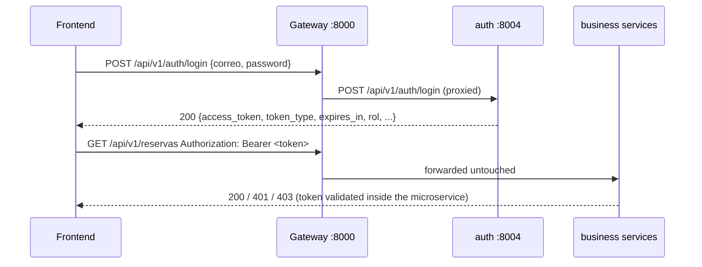

# Punto y Sal — API Integration Guide (Frontend)

> **Base URL (all requests):** `http://localhost:8000` (API Gateway).
> Every API path lives under `/api/v1/`. The gateway is the **single
> entry point**: the internal ports 8001/8002/8003/8004 must never be
> used by the frontend.
>
> Interactive Swagger UI: `http://localhost:8000/docs`.
> This document matches the actual implementation on branch
> `Dev/Noe-Mejia` (Sprint 2). If something here disagrees with `/docs`,
> `/docs` reflects the code and this file will be corrected.

---

## 1. Authentication at a glance



- Send **every** protected request with the header:
  `Authorization: Bearer <access_token>`
- Tokens are **JWT access tokens** (HS256) issued by
  `POST /api/v1/auth/login`. There are **no refresh tokens**: when a
  token expires (default 60 minutes), log in again.
- **Known limitation — no token revocation:** tokens already issued
  remain valid until they expire (default 60 minutes, configurable
  via `JWT_EXPIRE_MINUTES`). Deactivating an account only blocks **new**
  logins (uniform `401 Invalid credentials`); it does not invalidate
  tokens that were issued earlier. Without refresh tokens, the exposure
  window is bounded by the token lifetime.
- The gateway does **not** authenticate; each microservice validates
  the token itself. Identity and role always come from the signed
  token — never send identity fields expecting them to be trusted.
- The gateway forwards the `WWW-Authenticate: Bearer` challenge on 401s.

### Login

```http
POST /api/v1/auth/login
Content-Type: application/json
```

Request body (`additionalProperties` rejected → 422):

```json
{
  "correo": "<correo del administrador de prueba>",
  "password": "<password desde el entorno local>"
}
```

Success `200 OK`:

```json
{
  "access_token": "eyJhbGciOiJIUzI1NiIsInR5cCI6IkpXVCJ9...",
  "token_type": "bearer",
  "expires_in": 3600,
  "rol": "administrador",
  "correo": "admin.prueba@puntoysal.test",
  "id_usuario": 1,
  "id_cliente": null,
  "id_administrador": 1
}
```

| Field | Type | Meaning |
|---|---|---|
| `access_token` | string | JWT to send as `Authorization: Bearer …` |
| `token_type` | string | always `"bearer"` |
| `expires_in` | int | token lifetime in **seconds** (`JWT_EXPIRE_MINUTES`, default 60 min) |
| `rol` | string | `"administrador"` or `"cliente"` (the only roles that exist) |
| `correo` | string | login identity |
| `id_usuario` | int | account id (`sub` claim) |
| `id_cliente` | int\|null | client profile id (present when `rol="cliente"`) |
| `id_administrador` | int\|null | admin profile id (present when `rol="administrador"`) |

Failures:

| Status | Body | When |
|---|---|---|
| `401` | `{"detail":"Invalid credentials"}` | **any** login failure: unknown e-mail, wrong password or inactive account (`activo=false`) — one identical answer for every case, no account enumeration; header `WWW-Authenticate: Bearer` |
| `422` | `{"detail":[{...}]}` | invalid body (bad e-mail shape, missing field, extra field) |
| `503` | `{"detail":"Database connection failed"}` | database unreachable |

> Inactive accounts can never obtain a token: they receive the same
> `401 Invalid credentials` as a wrong password (there is deliberately
> no distinct "disabled" answer).

### JWT structure

Header `{"alg":"HS256","typ":"JWT"}` and claims:

| Claim | Type | Description |
|---|---|---|
| `sub` | string | `id_usuario` (stringified integer) |
| `rol` | string | `"administrador"` \| `"cliente"` |
| `correo` | string | account e-mail |
| `id_cliente` | int | client profile id — only for clients (may be absent if no profile is linked) |
| `id_administrador` | int | admin profile id — only for administrators (may be absent if no profile is linked) |
| `iat` | int | issued-at (unix seconds) |
| `exp` | int | expiry (unix seconds) = `iat + expires_in` |

Configuration (environment only, never in source): `JWT_SECRET`
(required, ≥32 chars, never exposed), `JWT_ALGORITHM` (default `HS256`),
`JWT_EXPIRE_MINUTES` (default `60`).

**Never** trust `rol`, `id_cliente`, `id_usuario` or any other claim
sent by the client outside the token (body/query): protected fields are
rejected with 422 (`extra="forbid"`).

### Token error semantics (all protected endpoints)

| Case | Status | Body | Header |
|---|---|---|---|
| Missing `Authorization` / non-Bearer | 401 | `{"detail":"Not authenticated"}` | `WWW-Authenticate: Bearer` |
| Malformed / garbage token | 401 | `{"detail":"Invalid authentication credentials"}` | same |
| Expired token | 401 | `{"detail":"Token has expired"}` | same |
| Wrong signature / wrong algorithm | 401 | `{"detail":"Invalid authentication credentials"}` | same |
| Signed token with unknown role or bad `sub` | 401 | `{"detail":"Invalid authentication credentials"}` | same |
| Valid token, insufficient role | 403 | `{"detail":"Not enough permissions"}` | — |
| Resource missing **or** owned by another user | 404 | `{"detail":"…"}` | — |

> A client asking for another client's profile/reservation gets **404**
> (not 403): ownership failures never reveal that the resource exists.

---

## 2. Role–permission matrix

| Endpoint (via gateway) | GET | POST | PUT/PATCH | DELETE |
|---|---|---|---|---|
| `/api/v1/auth/login` | — (405) | public | — | — |
| `/api/v1/clientes` | **administrador** | — | — | — |
| `/api/v1/clientes/{id}` | administrador **or owner** | — | administrador **or owner** | **administrador** |
| `/api/v1/clientes` (register) | — | **public** | — | — |
| `/api/v1/reservas` | **administrador** | authenticated¹ | — | — |
| `/api/v1/reservas/{codigo}` | administrador **or owner** | — | administrador **or owner**² | administrador **or owner**² |
| `/api/v1/catalogo/mesas[/{id}]` | **public** | administrador | administrador | administrador |
| `/api/v1/catalogo/platillos[/{id}]` | **public** | administrador | administrador | administrador |
| `/health`, `/health/services` | public | — | — | — |

¹ A client's reservation is always linked to the token's `id_cliente`;
supplying another customer's `id_cliente` → 403. Administrators must
send `id_cliente` (400 if missing).
² Clients may only set `estado="cancelada"` (any other `estado` → 403).
Status transitions themselves are validated by database rules → invalid
transitions answer 400 with the rule's message.

No other endpoint exists. Anything outside the routing map returns 404;
`GET /api/v1/auth/login` returns 405 (login is POST-only) and any other
`/api/v1/auth/...` path returns 404.

---

## 3. HTTP conventions

- All bodies are `Content-Type: application/json`.
- Success payloads wrap the record(s): list → `{"data": [ … ]}`,
  single → `{"data": { … }}`; the reservation detail adds
  `platillos` and `historial` (see §5.2).
- Timestamps are ISO-8601 **with UTC offset** (e.g.
  `2027-03-15T19:00:00-06:00`). Naive timestamps → 422.
- Prices are JSON numbers (`180.0`), sent as number or numeric string.
- Errors are always `{"detail": …}`; `422` uses FastAPI's array form
  `{"detail":[{"loc":["body","field"],"msg":"…","type":"…"}]}`.
- Logical deletes only: `DELETE` flips `activo=false` / `disponible=false`
  / `estado="cancelada"` — rows are never physically removed.
- Duplicate unique values → `409 {"detail":"…"}`.
- Business rules implemented as database triggers (state transitions,
  table availability/capacity) → `400 {"detail":"<rule message>"}`.
- `503` = database/service unreachable, `504` = downstream timeout; both
  with controlled JSON bodies (no internal URLs).

---

## 4. Catalog — `catalogo` (public reads, admin writes)

### 4.1 Tables (`mesas`)

```http
GET /api/v1/catalogo/mesas            # public
GET /api/v1/catalogo/mesas/{id_mesa}  # public; 404 {"detail":"Table not found"}
```

Row shape:

```json
{
  "id_mesa": 1,
  "numero_mesa": "M1",
  "capacidad": 4,
  "ubicacion": "Terraza",
  "estado": "disponible",
  "activa": true
}
```

`estado` ∈ `"disponible"` | `"mantenimiento"`.

```http
POST /api/v1/catalogo/mesas           # administrador -> 201
PATCH|PUT /api/v1/catalogo/mesas/{id} # administrador -> 200
DELETE /api/v1/catalogo/mesas/{id}    # administrador -> 200 (activa=false)
```

Create body:

```json
{"numero_mesa": "M9", "capacidad": 6, "ubicacion": "Salón", "estado": "disponible", "activa": true}
```

(`numero_mesa` 1–20 chars, required · `capacidad` > 0, required ·
`ubicacion` ≤100, nullable, optional · `estado`/`activa` optional with
defaults.) Update body: any subset of the same fields; unknown fields →
422; duplicate `numero_mesa` → 409; unknown id → 404.

### 4.2 Dishes (`platillos`)

```http
GET /api/v1/catalogo/platillos            # public
GET /api/v1/catalogo/platillos/{id}       # public; 404 {"detail":"Dish not found"}
```

Row shape:

```json
{
  "id_platillo": 1,
  "nombre": "Filete de pescado a la plancha",
  "descripcion": "Con arroz y ensalada",
  "precio": 180.0,
  "disponible": true,
  "fecha_creacion": "2026-11-01T12:00:00-06:00"
}
```

```http
POST /api/v1/catalogo/platillos            # administrador -> 201
PATCH|PUT /api/v1/catalogo/platillos/{id}  # administrador -> 200
DELETE /api/v1/catalogo/platillos/{id}     # administrador -> 200 (disponible=false)
```

Create body: `{"nombre": "…", "descripcion": "…", "precio": "180.00",
"disponible": true}` (`precio` ≥ 0 required, `nombre` 1–120 required).

---

## 5. Reservations — `reservas`

### 5.1 List (administrador only)

```http
GET /api/v1/reservas
Authorization: Bearer <admin token>
```

→ `200 {"data": [ <reserva>, … ]}` · without token 401 · client token 403.

Reservation row shape:

```json
{
  "id_reserva": 7,
  "codigo_reserva": "RES-A1B2-C3D4",
  "id_cliente": 1,
  "id_mesa": 3,
  "fecha_hora_inicio": "2027-03-15T19:00:00-06:00",
  "duracion_minutos": 120,
  "cantidad_personas": 4,
  "estado": "pendiente",
  "observaciones": "Cumpleaños",
  "fecha_creacion": "2026-11-02T12:00:00-06:00",
  "fecha_actualizacion": "2026-11-02T12:00:00-06:00",
  "id_administrador": null
}
```

`estado` ∈ `pendiente | aprobada | confirmada | rechazada | cancelada |
completada`. `codigo_reserva`, `estado="pendiente"`, status history and
notifications are **generated by the database**.

### 5.2 Detail (administrador or owner)

```http
GET /api/v1/reservas/{codigo_reserva}
Authorization: Bearer <token>
```

→ `200`:

```json
{
  "data": { …reserva… },
  "platillos": [
    {
      "id_platillo": 1,
      "nombre": "Filete de pescado a la plancha",
      "cantidad": 2,
      "precio_unitario": 180.0,
      "observaciones": null
    }
  ],
  "historial": [
    {
      "id_historial": 1,
      "estado_anterior": null,
      "estado_nuevo": "pendiente",
      "id_administrador": null,
      "comentario": null,
      "fecha_cambio": "2026-11-02T12:00:00-06:00"
    }
  ]
}
```

Another customer's code (or a bad code) → `404 {"detail":"Reservation not found"}`.

### 5.3 Create

```http
POST /api/v1/reservas
Authorization: Bearer <token>
```

Client body (identity comes from the token — do **not** send
`id_cliente` unless you are an administrator creating for a client):

```json
{
  "fecha_hora_inicio": "2027-03-15T19:00:00-06:00",
  "cantidad_personas": 4,
  "duracion_minutos": 120,
  "id_mesa": 3,
  "observaciones": "Cumpleaños",
  "platillos": [
    {"id_platillo": 1, "cantidad": 2, "observaciones": "Poco sal"}
  ]
}
```

| Field | Type | Rules |
|---|---|---|
| `fecha_hora_inicio` | ISO-8601 **with offset** | required (naive → 422) |
| `cantidad_personas` | int | required, > 0 |
| `duracion_minutos` | int | optional (default 120), 15–720 |
| `id_mesa` | int\|null | optional; must exist, be `activa`/`disponible` and hold the party (else 400 + rule message) |
| `observaciones` | string\|null | optional, ≤1000 |
| `id_cliente` | int\|null | **administrators only** (required for them); a client sending another id → 403 |
| `platillos` | array | optional, ≤50 items: `id_platillo` (int), `cantidad` (>0), `observaciones?` (≤500) |

Fields **not** accepted (422): `estado`, `codigo_reserva`,
`precio_unitario`, `id_administrador`, `fecha_creacion`, … Dish prices
are read from the catalog service, never from the request.

Responses:

- `201` → `{"data": <reserva>}` with `codigo_reserva` and
  `estado="pendiente"` already assigned by the database.
- `400` → `{"detail":"Dish 999 does not exist"}` (unknown dish) or the
  database rule message (e.g. mesa unavailable).
- `401` no/invalid token · `403` client without profile or foreign
  `id_cliente` · `409` duplicate dish line · `422` invalid body ·
  `409/400` unique/FK conflicts.

### 5.4 Modify

```http
PATCH|PUT /api/v1/reservas/{codigo_reserva}
Authorization: Bearer <token>
```

Body (any subset; unknown keys → 422):
`{"fecha_hora_inicio"?, "duracion_minutos"?, "cantidad_personas"?,
"id_mesa"?, "observaciones"?, "estado"?}`.

- **Client:** only `{"estado": "cancelada"}` is accepted; any other
  `estado` → `403 {"detail":"Only cancellation is allowed for clients"}`.
  Not your reservation → 404.
- **Administrator:** any `estado` request; the database validates the
  transition (e.g. `confirmada → pendiente`) and answers
  `400 {"detail":"Transición de estado no permitida: confirmada → pendiente."}`
  when illegal. Acting admin id is stamped on the row/history.
- Success → `200 {"data": <reserva>}`; missing → 404.

### 5.5 Cancel (logical delete)

```http
DELETE /api/v1/reservas/{codigo_reserva}
Authorization: Bearer <token>   # owner or administrador
```

Sets `estado="cancelada"` (history/notifications created by triggers).

- `200` → `{"data": <reserva>}` with `estado="cancelada"`.
- `400` → database rule message, e.g. a `completada` reservation cannot
  be cancelled: `{"detail":"Transición de estado no permitida: completada → cancelada."}`.
- `404` → unknown code or not your reservation.

---

## 6. Customers — `clientes`

### 6.1 Self-registration (public)

```http
POST /api/v1/clientes
Content-Type: application/json
```

```json
{
  "nombre_completo": "Ana López",
  "correo": "ana@ejemplo.com",
  "password": "ClaveSegura2026",
  "telefono": "+504 9999-0001",
  "numero_identidad": "0801199000123"
}
```

- `password`: 8–72 characters **and ≤72 UTF-8 bytes** (bcrypt limit).
- `numero_identidad` optional (nullable); `correo` must be unique.
- The account is always created with `rol="cliente"`, `activo=true` —
  `rol`, `activo`, `id_usuario`, `password_hash` in the body → **422**.
- `201` → `{"data": <cliente>}` (no password/hash ever in the response).
- `409` → `{"detail":"Email or identity number already registered"}`.
- `422` invalid body (e-mail shape, short password, extra fields).

Cliente row shape:

```json
{
  "id_cliente": 5,
  "nombre_completo": "Ana López",
  "numero_identidad": "0801199000123",
  "telefono": "+504 9999-0001",
  "correo": "ana@ejemplo.com",
  "fecha_registro": "2026-11-01T12:00:00-06:00",
  "activo": true
}
```

`id_usuario`, `password_hash` are never returned by any endpoint.

### 6.2 List (administrador only)

```http
GET /api/v1/clientes
Authorization: Bearer <admin token>
```

→ `200 {"data": [<cliente>, …]}` · no token → 401 · client token → 403.

### 6.3 Read one (administrador or owner)

```http
GET /api/v1/clientes/{id_cliente}
Authorization: Bearer <token>
```

→ `200 {"data": <cliente>}`; a client asking for a different
`id_cliente` → `404 {"detail":"Customer not found"}`.

### 6.4 Update (administrador or owner)

```http
PATCH|PUT /api/v1/clientes/{id_cliente}
Authorization: Bearer <token>
```

Accepted fields (any subset; unknown → 422): `nombre_completo`,
`telefono`, `correo`, `numero_identidad`.

- `numero_identidad` may be sent as `null` (clears it); the other
  fields reject explicit `null` → 422.
- Changing `correo` also updates the login identity (`usuarios.correo`)
  atomically; a taken e-mail → 409.
- `200` → `{"data": <cliente>}` · 404 if missing/not yours.

### 6.5 Deactivate (administrador only)

```http
DELETE /api/v1/clientes/{id_cliente}
Authorization: Bearer <admin token>
```

Logical: sets `activo=false` on the profile **and** the account (that
account can no longer log in → `401 Invalid credentials`). Reservations
keep their foreign keys. → `200 {"data": <cliente>}` · `404` unknown
id · client token → 403.

---

## 7. Gateway behaviour

| Gateway route | Methods | Forwards to |
|---|---|---|
| `/api/v1/auth/login` | POST | auth service (explicit route; other auth paths are not routed → 404) |
| `/api/v1/clientes`, `/api/v1/clientes/{path}` | GET, POST, PUT, PATCH, DELETE | clientes service |
| `/api/v1/reservas`, `/api/v1/reservas/{path}` | GET, POST, PUT, PATCH, DELETE | reservas service |
| `/api/v1/catalogo`, `/api/v1/catalogo/{path}` | GET, POST, PUT, PATCH, DELETE | catalogo service |
| `/health` | GET | gateway itself |
| `/health/services` | GET | aggregated `/health` of the four services |

- Request headers (including `Authorization`) are forwarded untouched;
  response status codes, JSON bodies and `WWW-Authenticate` come back
  unchanged. Internal URLs/ports are never exposed.
- Downstream unavailable → `503 {"detail":"Service 'x' is unavailable","service":"x"}`;
  timeout (10 s) → `504 {"detail":"Service 'x' did not respond in time","service":"x"}`.
- CORS is **opt-in** via the `CORS_ORIGINS` environment variable
  (comma-separated origins, e.g. `https://app.example.com`). Empty → no
  CORS headers at all. Allowed methods: the five above; allowed headers:
  `Authorization`, `Content-Type`; credentials (cookies) disabled —
  the frontend must use the bearer token.
- Swagger: gateway `http://localhost:8000/docs`; each service also
  exposes its own `/docs` on its internal port (testing only).

---

## 8. Worked examples (curl)

> The test-account credentials come **only** from your local environment
> (they are never stored in this repository). Export them first:
>
> ```bash
> export ADMIN_EMAIL="..." ADMIN_PASSWORD="..."   # from the team's local env
> export CLIENT_EMAIL="..." CLIENT_PASSWORD="..."
> ```

### 8.1 Administrator login + protected list

```bash
BASE=http://localhost:8000

# 1) login
ADMIN_TOKEN=$(curl -s -X POST $BASE/api/v1/auth/login \
  -H "Content-Type: application/json" \
  -d "{\"correo\":\"$ADMIN_EMAIL\",\"password\":\"$ADMIN_PASSWORD\"}" \
  | python -c "import sys,json;print(json.load(sys.stdin)['access_token'])")

# 2) use it
curl -s $BASE/api/v1/clientes \
  -H "Authorization: Bearer $ADMIN_TOKEN"
```

### 8.2 Client login + own reservation

```bash
CLIENT_TOKEN=$(curl -s -X POST $BASE/api/v1/auth/login \
  -H "Content-Type: application/json" \
  -d "{\"correo\":\"$CLIENT_EMAIL\",\"password\":\"$CLIENT_PASSWORD\"}" \
  | python -c "import sys,json;print(json.load(sys.stdin)['access_token'])")

# Public catalog read (no token needed)
curl -s $BASE/api/v1/catalogo/platillos

# Create a reservation (identity from the token)
curl -s -X POST $BASE/api/v1/reservas \
  -H "Authorization: Bearer $CLIENT_TOKEN" \
  -H "Content-Type: application/json" \
  -d '{"fecha_hora_inicio":"2027-03-15T19:00:00-06:00","cantidad_personas":2,"platillos":[{"id_platillo":1,"cantidad":1}]}'

# Cancel it (only allowed state change for clients)
curl -s -X PATCH $BASE/api/v1/reservas/RES-A1B2-C3D4 \
  -H "Authorization: Bearer $CLIENT_TOKEN" \
  -H "Content-Type: application/json" \
  -d '{"estado":"cancelada"}'
```

### 8.3 Expected failure responses

```bash
# No token -> 401 + WWW-Authenticate
curl -si $BASE/api/v1/reservas | head -n1            # HTTP/1.1 401 Unauthorized
curl -s  $BASE/api/v1/reservas                       # {"detail":"Not authenticated"}

# Client token on an admin endpoint -> 403
curl -s $BASE/api/v1/reservas -H "Authorization: Bearer $CLIENT_TOKEN"
# {"detail":"Not enough permissions"}

# Another client's reservation -> 404 (ownership)
curl -s $BASE/api/v1/reservas/RES-DE-OTRO -H "Authorization: Bearer $CLIENT_TOKEN"
# {"detail":"Reservation not found"}

# Wrong password -> 401 (identical for unknown users and inactive accounts)
curl -s -X POST $BASE/api/v1/auth/login -H "Content-Type: application/json" \
  -d "{\"correo\":\"$ADMIN_EMAIL\",\"password\":\"wrong\"}"
# {"detail":"Invalid credentials"}
```

> **Local/integration test accounts** (development only): their
> credentials live in the team's local environment, never in source
> code, documentation or production configuration.

---

## 9. Frontend checklist

- [ ] Store `access_token` (memory/sessionStorage) and a login timer
      based on `expires_in`; re-login on 401 (`Token has expired`).
- [ ] Send `Authorization: Bearer <token>` on every request except
      `POST /api/v1/auth/login`, `POST /api/v1/clientes` (register) and
      the public `GET /api/v1/catalogo/**`.
- [ ] Never send identity/role fields (`id_cliente`, `rol`, …) except
      `id_cliente` when an administrator creates a reservation for a
      client; the backend derives the client from the token otherwise.
- [ ] Render `403` as "not allowed", `404` as "not found (or not yours)",
      `409` as "already exists", `422` field errors inline,
      `400 detail` as the business-rule message.
- [ ] Handle `503/504` as transient backend issues (retry/notify).
- [ ] Configure the backend's `CORS_ORIGINS` with the frontend origin
      before enabling cross-origin calls.
